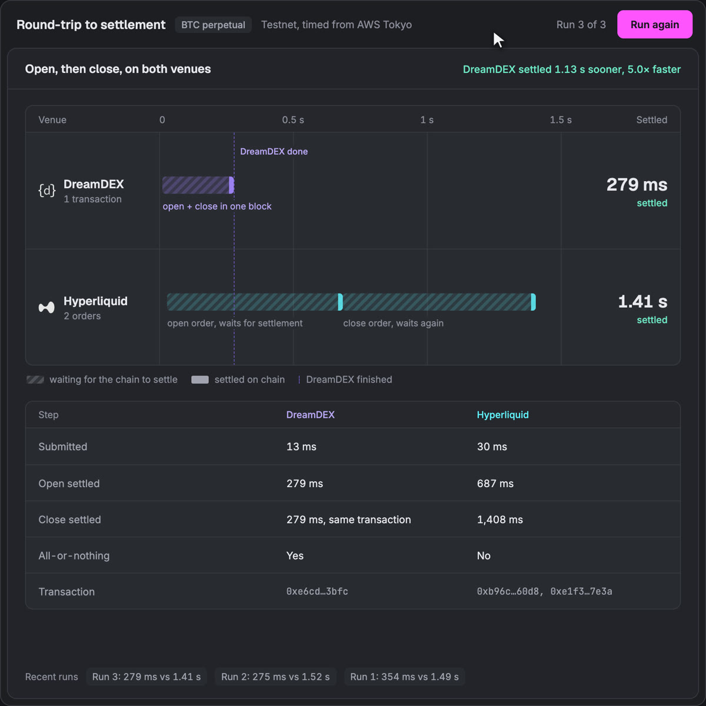

# Perp round-trip comparison: DreamDEX vs Hyperliquid

A live, reproducible demo of something DreamDEX on Somnia does that Hyperliquid
cannot: **a bot opens and closes a perp position in one atomic on-chain
transaction.**

Same task on both venues — *open a BTC perpetual, then close it* — fired from one
board, timed to on-chain settlement, with every transaction hash recorded.



## The result (measured, reproducible)

One press of Start runs the round trip on both venues at the same moment. Each row
fills when its chain settles. The two facts that never change:

- **DreamDEX: 1 transaction, open and close settle together, all-or-nothing.** The
  wallet is EIP-7702-delegated to a batcher, so one call places both orders on the
  pool's on-chain order book.
- **Hyperliquid: 2 orders that settle one after the other.** The close is
  reduce-only, so it cannot be sent until the open has settled on HyperCore.

Measured from one server in AWS Tokyo (`ap-northeast-1`), next to both venues, three
consecutive runs:

| Run | DreamDEX (1 tx) | Hyperliquid open | Hyperliquid total (2 orders) | Ratio |
|---|---|---|---|---|
| 1 | 354 ms | 769 ms | 1.49 s | 4.2× |
| 2 | 275 ms | 808 ms | 1.52 s | 5.5× |
| 3 | **279 ms** | 687 ms | **1.41 s** | **5.0×** |

Hyperliquid's open order alone takes longer than DreamDEX's whole round trip.
Milliseconds vary run to run; the shape (one settlement against two) does not. The
three timelines are committed in `runs/` with every hash.

## How it works

**DreamDEX side** — `src/dreamdex.mjs`. The wallet's code is an EIP-7702 delegation
to Somnia's `SessionDelegate` batcher. One transaction to the wallet itself calls
`execute([open, close])`: an IOC buy, then an IOC sell, on the BTC-PERP pool. The
order book is a contract, so both legs match inside that one execution and settle
when the block includes it.

**Hyperliquid side** — `src/hyperliquid.mjs`. An approved agent wallet sends a signed
IOC buy to the testnet API, waits for HyperCore to settle the fill, then sends a
reduce-only IOC sell, which settles in a second consensus round.

**The board** — `server.mjs` + `public/index.html`: one Start button. Both venues run
in parallel; events stream to the page over Server-Sent Events, and each run is
saved as a JSON timeline in `runs/`. Keys stay on the server; the page only receives
events.

## Reproduce it yourself

You need Node 20+ (for `--env-file`), testnet only.

```bash
npm install
cp .env.example .env.local   # then paste your values in
```

You need two throwaway credentials:

- **DreamDEX (Somnia Hideki testnet):** an EOA with STT for gas and USDso for perp
  margin.
- **Hyperliquid testnet:** an agent (API) wallet approved on a funded testnet
  account, plus that account's address. The agent can trade but not withdraw.

```bash
# 1. DreamDEX one-time setup: approve + deposit margin, attach the EIP-7702 delegation
npm run setup

# 2. run the board
npm run board                # http://localhost:8800

# command-line measurement, if you prefer:
npm run dreamdex             # one atomic open + close
npm run hyperliquid          # open order, then reduce-only close
```

Replay a saved run with no keys and no trades:
`http://localhost:8800/?replay=/runs/sample-race.json`, or all three back to back
with `?seq=/runs/sample-race-1.json,/runs/sample-race-2.json,/runs/sample-race.json`.
Add `&start=1.7` for the recording mode, where a cursor clicks Start before each run
(the board exposes `window.setT(seconds)` for frame-exact capture).

Helper scripts:
- `scripts/setup.mjs` — margin approval, deposit and EIP-7702 delegation (idempotent)
- `scripts/dreamdex-measure.mjs` — one DreamDEX round trip, printed as a timeline
- `scripts/hyperliquid-measure.mjs` — one Hyperliquid round trip, printed as a timeline

## Chain facts

| Venue | Network | Endpoint | Market |
|---|---|---|---|
| DreamDEX | Somnia Hideki testnet, chain 50383 | `https://api.hideki2.infra.testnet.somnia.network` | BTC-PERP pool `0x4181dd08E73BbCdd1Ba3E615A18f6abD941b94C0`, 0.00013 BTC (market minimum) |
| Hyperliquid | Hyperliquid testnet | `https://api.hyperliquid-testnet.xyz` | BTC perp (asset 3), 0.0002 BTC |

Hideki has no public block explorer yet; the DreamDEX hashes in `runs/` can be read
back with `eth_getTransactionReceipt` against the RPC above.

## Honest caveats

- **This is a capability story, not a gas story.** On Somnia the EIP-7702
  authorization costs about 1.57M gas, so batching saves nothing on fees. The gain is
  one all-or-nothing transaction you sign yourself.
- **Hyperliquid's ~700 ms per order is real on-chain settlement.** A read from the
  same server took ~9 ms, so the time is HyperCore consensus, not network delay. Its
  API can batch several orders in one signed action, but a reduce-only close still
  needs the open to have filled, and there is no single on-chain open-and-close. A
  contract trading on HyperCore goes through CoreWriter, which settles
  asynchronously.
- **Location matters.** From a laptop on the public internet the same DreamDEX round
  trip read ~1.4 s. Measure next to the venues or expect inflated numbers.
- Testnet figures. Testnet performance is not a mainnet SLA. Order sizes differ
  slightly because each venue has its own minimum.

## What is NOT in this repo

The private keys. `.env*` is gitignored except `.env.example`. Bring your own funded
testnet throwaways.
